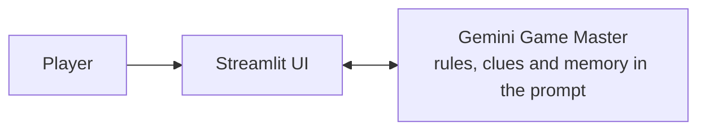
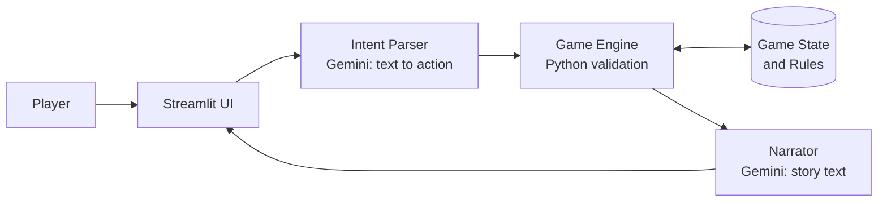

# AI Escape Room

An escape-room game played in plain English, with a Large Language Model (Google Gemini) as the Game Master. You wake up in a locked library, search for clues, solve three puzzles and open the door.

The project is built twice to show a real problem with LLM applications and how to solve it:

- **Version 1** lets the LLM run the whole game. It is quick to build and fun to play, but it can forget, invent things and be talked into breaking the rules.
- **Version 2** moves the rules, state and solutions into Python. The LLM only understands the player's words and describes the result, so the game stays consistent and cannot be cheated with prompts.

## Features

- Chat interface built with Streamlit
- Five interactive objects, three puzzles and a final escape
- Inventory, progress tracking and a restart button (Version 2)
- Action validation: you can only use items you have collected
- Handles invalid actions, wrong codes, false claims and "I am the administrator" tricks
- Works offline without an API key (Version 2)
- 26 automated tests

## Versions at a glance

| | Version 1 | Version 2 |
|---|---|---|
| Who runs the game | The LLM | A Python game engine |
| Game state | Chat history | Structured dictionary |
| Puzzle solutions | Inside the prompt | In a JSON file, never sent to the LLM |
| Cheating attempts | Depend on the LLM | Refused by validation |
| Works without an API key | No | Yes |

## Architecture

**Version 1**



**Version 2**



Python is the only part that changes the game. The LLM never sees the secret codes.

## The puzzle

The room contains a desk, a bookshelf, a painting, a locked drawer and a door with a keypad.

<details>
<summary>Spoiler: solution</summary>

1. Examine the desk and take the magnifying glass.
2. Examine the bookshelf, then the four books. The numbers give the drawer code 4281.
3. Enter 4281 on the drawer and take the torn page. It shows 58.
4. Use the magnifying glass on the painting. It shows 36.
5. Enter 5836 on the door, then open it.

</details>

## Getting started

### Requirements

- Python 3.10 or newer
- A free Gemini API key from https://aistudio.google.com/apikey (optional for Version 2)

### Install

```bash
git clone https://github.com/<your-username>/AI-Escape-Room.git
cd AI-Escape-Room
python3 -m venv .venv
source .venv/bin/activate        # Windows: .venv\Scripts\activate
pip install -r requirements.txt
```

### Configure

Copy the example file and add your key:

```bash
cp .env.example .env
```

```
GEMINI_API_KEY=your_key_here
GEMINI_MODEL=gemini-3.8-flash
```

`.env` is ignored by git, so your key is never uploaded. If a model name stops working, change `GEMINI_MODEL`.

### Run

```bash
streamlit run v1_basic/app.py      # Version 1 (needs an API key)
streamlit run v2_reliable/app.py   # Version 2
```

Open http://localhost:8501 and type actions such as:

```
examine the desk
take the magnifying glass
use the magnifying glass on the painting
enter 1234 on the drawer
open the door
```

## Tests

```bash
pytest -v
```

The tests run offline and cover the full walkthrough, uncollected and non-existent items, wrong codes, false "already solved" claims, administrator impersonation, secret extraction and forged actions. More cases are in [docs/TEST_CASES.md](docs/TEST_CASES.md).

## Project structure

```
AI-Escape-Room/
├── v1_basic/
│   └── app.py                 Version 1
├── v2_reliable/
│   ├── app.py                 Streamlit interface
│   ├── controller.py          one turn: parse, validate, narrate
│   ├── engine.py              game state, validation, rules
│   ├── parser.py              action schema and offline parser
│   ├── llm.py                 Gemini parser, narrator, number guard
│   └── game_config.json       objects, items, secrets, texts
├── tests/
│   └── test_v2_engine.py
├── docs/
│   ├── REPORT.docx            project report
│   ├── TEST_CASES.md          Version 1 vs Version 2 test cases
│   └── architecture.png       architecture diagram
├── .env.example
├── requirements.txt
└── README.md
```

## Limitations

- A correct code guessed without finding the clues still works, because it is a valid solution.
- One room and one player, with state kept in memory for the browser session.
- The free Gemini tier has rate limits. Version 2 falls back to plain text if the API fails.

## Documentation

The design, implementation, problems encountered and improvements are described in [docs/REPORT.docx](docs/REPORT.docx).
